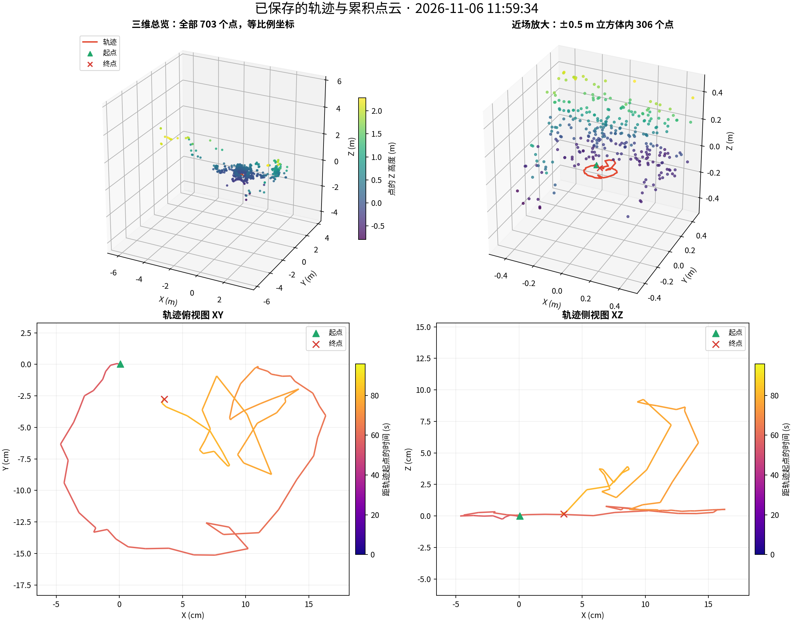

# 小组共享数据

更新日期：2026-11-18。之前忽略了运行输出目录，导致组员只能拿到源码和棋盘标定原图。本次将精选实验输出直接纳入 Git，并发布完整历史数据附件。

## 先更新代码与样例

```bash
git pull --ff-only
```

| 数据 | 位置 | 可用于什么 |
| --- | --- | --- |
| VINS 轨迹、点云与预览 | [examples/vins_20261106](examples/vins_20261106/) | 386 个位姿、703 个稀疏点；阅读 TUM/CSV、点云显示和结果分析 |
| ORB3 RGB-D 验证轨迹 | [examples/orb3_rgbd_20261113](examples/orb3_rgbd_20261113/) | 1128 个实时位姿及优化轨迹；检查输出格式 |
| ORB3 稀疏地图 | [examples/orb3_sparse_map_20261113](examples/orb3_sparse_map_20261113/) | 5696 个特征点，二进制 PLY，坐标系为 orb3_map |
| 棋盘原图、角点与报告 | [48 对原图](../vins_ws/calibration/checkerboard/session_20261106_1045/) | 重算和核对既有双目标定 |
| 全部历史运行与数值诊断 | [数据 Release](https://github.com/xhljxtlaa/d435i-slam-team/releases/tag/data-20261118) | 217 个原始文件，含多次 ORB3 运行、VINS 历史输出、标定和 IMU 诊断 |
| 同步红外＋深度＋IMU rosbag | **尚未录制或找到** | 目前不能直接离线重跑完整定位链路 |

VINS 可直接查看这张已保存的实验预览：



## 下载完整历史数据

无需 GitHub 登录，运行：

```bash
python3 scripts/fetch_data.py
```

脚本下载约 24 MB，检查 `data/release.json` 中的 SHA256，并解压到忽略的 `data/downloads/d435i-data-20261118/`。也可以从 Release 页面手动下载 `.tar.gz` 和 `SHA256SUMS`；`git pull` 本身只包含上表的精选样例，不自动下载 Release 附件。

数据包内：

- `orb3/run_*/`：保留的运行轨迹、相机配置、稀疏与历史表面地图及地图段快照。
- `vins/output/`：实验轨迹、稀疏点云、配置、图片及排查阶段备份。
- `calibration/`：48 对棋盘 PNG、角点观测、标定报告。
- `diagnostics/`：实际采集的 IMU CSV、数值 NPZ 和诊断报告。
- `MANIFEST.json`：217 个原文件的 SHA256 与大小。

`data/index.json` 给出随 Git 提供的 22 个样例文件的来源分类、校验和及位姿/点数。

## 数据含义与限制

轨迹都是算法估计结果，没有提供 ground truth。VINS 样例的轨迹和点云是在运行中分别保存的，不能视作严格同步的一对；原始 `trajectory_raw.csv` 时间戳曾舍入到整秒，分析时间用 `trajectory.tum`。

ORB3 稀疏地图来自 `run_20261113_115824_Zt4I1K` 的末次地图，`map_id=4`。完整数据包中该次运行的轨迹有 4 个 `# segment` 边界，不能把整份轨迹与最后一张地图当成同一连续坐标系。表面地图是此前密集模式的历史产物，当前启动仍默认仅显示稀疏特征点。

数据包保留了排查阶段失败、发散与重置片段，包括异常点云备份；它们供故障分析使用。选择结果时参照 [STATUS](../docs/STATUS.md) 和相应运行审计。

原始 IMU CSV 与 NPZ 确实是传感器采样，但缺少对应的同步红外/深度图。`stationary_raw.npz` 的 `left/right` 数组仅为图像时间戳，不含像素。棋盘 PNG 是离散标定图，不是定位连续帧；不能将它们拼成此前运行的真实 rosbag。

## 有相机后补录原始数据

当前没有连接 D435i，因此本次未补录原始回放包。仓库已增加采集入口：

```bash
# 终端一：启动相机
./orb3_ws/start_camera.sh

# 终端二：默认录制 20 秒，也可以指定 60
./scripts/record_bag.sh 20 "静置，桌面有纹理；仅用于数据链路检查"
```

输出位于 `data/recordings/日期时间_随机后缀/`，包含 rosbag、相机快照、VINS 配置、录制说明与 topic 计数。只有必需输入均有消息才标记为采集成功。原始图像体积较大，不自动提交；先检查录制场景和 topic 完整性，再作为新的 Release 数据附件共享。

后续回放流程和验收项目见 [RAW_RECORDING](../docs/RAW_RECORDING.md)。本次检查仅验证脚本的离线部分，尚未进行真实相机采集与算法回放验收。
